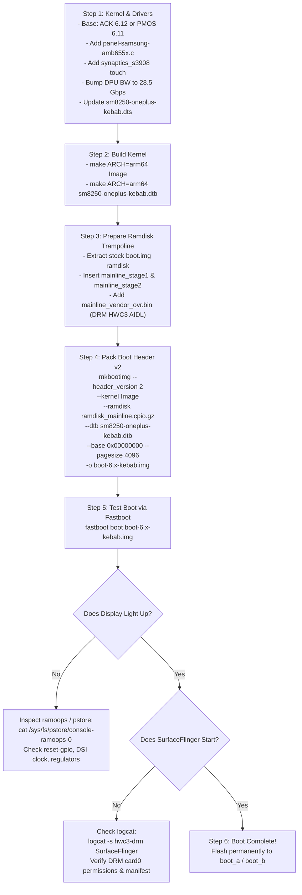

# Mainline Linux 6.x Bringup Guide: OnePlus 8T (`kebab`) on Android 17 (AOSP)

---

## 1. Executive Summary & Hardware Profile

Porting mainline Linux (Kernel 6.x / Google ACK 6.12) to the **OnePlus 8T (`kebab`)** running **Android 17 (Clover / SDK 37)** builds upon the architecture proven on Xiaomi POCO F3 (`alioth`). However, OnePlus 8T has crucial differences in bootloader architecture, partition layout, display hardware, and touchscreen controllers that dictate specific bringup steps.

### Comparison: OnePlus 8T (`kebab`) vs. POCO F3 (`alioth`)

| Hardware / Subsystem | POCO F3 (`alioth`) | OnePlus 8T (`kebab`) | Mainline / Android 17 Impact |
| :--- | :--- | :--- | :--- |
| **SoC** | Qualcomm Snapdragon 870 (`SM8250-AC`) | Qualcomm Snapdragon 865 (`SM8250`) | Identical CPU/GPU/DPU/DSP hardware blocks. |
| **Boot Header Version** | **v3** (`vendor_boot` mandatory) | **v2** (Header v2, no `vendor_boot`) | **Major win for Kebab**: DTB is embedded directly in `boot.img`; `fastboot boot` works out-of-the-box without modifying on-flash partitions. |
| **Boot Partitions** | `boot_a`/`b` (64MB) + `vendor_boot_a`/`b` (64MB) | `boot_a`/`b` (96MB) + `dtbo_a`/`b` (24MB) | Standard Android Header v2 packaging with `--header_version 2 --dtb <dtb>`. |
| **Display Panel** | Samsung AMS667xx01 (1080x2400 @ 120Hz) | **Samsung AMB655X** (1080x2400 @ 120Hz/60Hz) | Command-mode AMOLED with VESA DSC (Display Stream Compression) 2:1. Requires `panel-samsung-amb655x.c`. |
| **Display Backlight** | PMIC WLED / DSI DCS | **DSI DCS** (`bl_ctrl_dcs`, command `0x51`) | Standard DCS 12-bit backlight (0 to 4095). |
| **Display Reset / TE** | Reset GPIO 75, TE GPIO 66 | Reset **GPIO 75**, TE **GPIO 66**, VOUT **GPIO 24** | Dedicated fixed regulator for AVDD enabled via **GPIO 61**. |
| **Touchscreen IC** | FocalTech FT8756 (SPI) | **Synaptics S3908** (I2C addr `0x4B`) | Connected to `&qupv3_se13_i2c` (`&i2c13`), IRQ GPIO 39, Reset GPIO 38. |
| **Audio Codec** | WCD9385 + WSA8830 | WCD9385 + WSA8810 / WSA8815 | Qualcomm Soundwire / Slpi audio pipeline. |
| **Display HAL (AOSP)**| DRM HWComposer AIDL (`hwc3`) | DRM HWComposer AIDL (`hwc3`) | Replaces stock `vendor.qti.hardware.display.composer` via RAM OverlayFS. |

---

## 2. Bootloader & Boot Image Architecture

### 2.1 The Header v2 Advantage on OnePlus 8T
On POCO F3 (`alioth`), Android Boot Header v3 splits the boot image into `boot.img` (kernel + generic ramdisk) and `vendor_boot.img` (vendor ramdisk + DTB). Crucially, the Xiaomi ABL bootloader ignores DTBs sent over USB during `fastboot boot <image>` and reads the on-flash DTB from `vendor_boot`.

**OnePlus 8T uses Android Boot Header v2**:
```
+---------------------------------+
| Android Boot Image Header (v2)  |  (Page 0: 4096 bytes)
+---------------------------------+
| Kernel (Image / Image.gz)       |
+---------------------------------+
| Ramdisk (AOSP + Trampoline)     |
+---------------------------------+
| Second Stage (Unused / 0)       |
+---------------------------------+
| Recovery DTBO (Unused / 0)      |
+---------------------------------+
| Device Tree Blob (DTB)          |  <-- Appended DTB section in header v2!
+---------------------------------+
```
Because the DTB is packaged directly within `boot.img`, **ABL parses both the 6.x kernel and the 6.x DTB simultaneously**. This allows clean non-destructive testing via:
```bash
fastboot boot boot-6.x-kebab.img
```

### 2.2 Board ID Matching in ABL
Downstream 4.19 `kona-kebab-overlay.dts` reveals the board ID checked by OnePlus ABL:
```dts
qcom,msm-id = <0x164 0x10000>, <0x164 0x20001>;  /* SM8250 v1.0 and v2.1 */
qcom,board-id = <0x10008 0>;                       /* OnePlus Kebab MTP */
oplus,dtsi_no = <19805 20809>;                     /* Project IDs */
```
To ensure OnePlus ABL boots the mainline DTB without rejecting it, `sm8250-oneplus-kebab.dts` must specify:
```dts
qcom,msm-id = <0x164 0x10000>, <0x164 0x20001>;
qcom,board-id = <0x10008 0>, <0x08 0x00>;
```

---

## 3. Hardware Subsystem Specifications

### 3.1 Display Panel: Samsung AMB655X
From `dsi-panel-oplus20828-samsung-amb655x-1080-2400-120fps.dtsi`:
- **Interface**: 4-lane MIPI DSI, Command Mode (`dsi_cmd_mode`).
- **Resolution**: 1080 x 2400.
- **Physical Dimensions**: 70mm width x 151mm height.
- **Refresh Rates**: 120Hz (default) and 60Hz.
  - **120Hz Timings**:
    - Pixel Clock: 1.10 GHz DSI clock rate.
    - H-Front Porch: 52, H-Back Porch: 24, H-Pulse Width: 24 (Total H = 1180).
    - V-Front Porch: 4, V-Back Porch: 8, V-Pulse Width: 4 (Total V = 2416).
  - **60Hz Timings**:
    - V-Front Porch: 1208, V-Back Porch: 8, V-Pulse Width: 4 (Total V = 3620).
- **VESA DSC Compression**:
  - Slices: 2 slices per line (`slice_width = 540`, `slice_height = 30`).
  - Bit per component: 8 bpc; Bit per pixel: 8 bpp.
  - Block prediction enabled.
- **Power Supplies & Control GPIOs**:
  - `vddio`: `pm8150_l14` (1.8V).
  - `vdd`: `pm8150a_l11` (3.1V - 3.3V).
  - `avdd`: 5.5V fixed regulator triggered by **GPIO 61** (`display_panel_avdd`).
  - `panel-vout`: **GPIO 24** (`tlmm 24`).
  - `reset-gpio`: **GPIO 75** (`tlmm 75`, active-low reset).
  - `te-gpio`: **GPIO 66** (`tlmm 66`).
- **Backlight**: DSI DCS commands (`0x51` write display brightness, 12-bit depth: 1 to 4095).

### 3.2 Touchscreen: Synaptics S3908
From `kona-mtp.dtsi` lines 214–250:
- **IC**: Synaptics ClearPad S3908.
- **I2C Bus**: `&qupv3_se13_i2c` (mapped to `&i2c13` in mainline).
- **I2C Address**: `0x4B` (`synaptics@4b`).
- **Coordinates**: X = 0..1079, Y = 0..2399 (10-point multitouch).
- **Interrupt (IRQ)**: **GPIO 39** (`<&tlmm 39 IRQ_TYPE_EDGE_FALLING>`).
- **Reset**: **GPIO 38** (`<&tlmm 38 GPIO_ACTIVE_LOW>`).
- **Power Rails**:
  - Digital VCC (`vcc_1v8`): `pm8150a_l1` (1.8V).
  - Analog VDD (`vdd_2v8`): `pm8150_l13` (3.0V).

---

## 4. Required Kernel Patches & Drivers

### 4.1 Display Processing Unit (DPU) Bandwidth Bump
In `drivers/gpu/drm/msm/disp/dpu1/catalog/dpu_6_0_sm8250.h`:
Upstream default `max_bw_high` is **16.6 Gbps** (`16600000`). At 1080x2400 @ 120Hz with UI blending, the DPU core bandwidth calculator exceeds 16.6 Gbps, returning `-E2BIG` to DRM atomic commit and crashing SurfaceFlinger.
```c
/* Patch: drivers/gpu/drm/msm/disp/dpu1/catalog/dpu_6_0_sm8250.h */
- .max_bw_high = 16600000,
+ .max_bw_high = 28500000,
```

### 4.2 DRM Panel Driver (`panel-samsung-amb655x.c`)
Add the Caleb Connolly / Linaro upstream driver into `drivers/gpu/drm/panel/panel-samsung-amb655x.c` and register it in `drivers/gpu/drm/panel/Kconfig` and `Makefile`.

The driver handles:
1. Power rail enablement (`pm8150_l14`, `pm8150a_l11`, GPIO 61 AVDD enable).
2. Reset toggle sequence on GPIO 75: `high (10ms) -> low (1ms) -> high (10ms)`.
3. Sending DSC ON configuration sequence in `dsi_lp_mode`.
4. Refresh rate switching (120Hz vs 60Hz) via DSI DCS timing command (`0xF0 0x5A 0x5A ... 0x60 [0x00|0x10]`).
5. Standard DRM backlight registration via `drm_panel_of_backlight`.

### 4.3 Synaptics S3908 Touchscreen Support
Enable `CONFIG_TOUCHSCREEN_RMI4_I2C=y` or integrate the standalone `synaptics_s3908` I2C driver to bind against `synaptics@4b`.

### 4.4 Kernel Configuration (`defconfig`)
Ensure the following are enabled in the 6.x defconfig:
```ini
# Android Userspace Core
CONFIG_ANDROID_BINDER_IPC=y
CONFIG_ANDROID_BINDERFS=y
CONFIG_ASHMEM=y

# Memory & Graphic Heaps
CONFIG_DMABUF_HEAPS=y
CONFIG_DMABUF_HEAPS_SYSTEM=y
CONFIG_DMABUF_HEAPS_CMA=y

# DRM & Display
CONFIG_DRM_MSM=y
CONFIG_DRM_PANEL_SAMSUNG_AMB655X=y
CONFIG_DRM_PANEL_ORIENTATION_QUIRKS=y

# Touchscreen & Input
CONFIG_INPUT_TOUCHSCREEN=y
CONFIG_TOUCHSCREEN_SYNAPTICS_DSX=y
# or CONFIG_TOUCHSCREEN_RMI4_I2C=y

# Storage & OverlayFS
CONFIG_OVERLAY_FS=y
CONFIG_EROFS_FS=y
CONFIG_F2FS_FS=y
CONFIG_FS_ENCRYPTION=y
```

---

## 5. Mainline Device Tree (`sm8250-oneplus-kebab.dts`)

Update `arch/arm64/boot/dts/qcom/sm8250-oneplus-kebab.dts`:

### 5.1 Touchscreen Node Replacement
Replace the placeholder `touchscreen@48` with the actual Synaptics controller:
```dts
&i2c13 {
	status = "okay";
	clock-frequency = <400000>;

	touchscreen@4b {
		compatible = "synaptics,s3908";
		reg = <0x4b>;
		interrupt-parent = <&tlmm>;
		interrupts = <39 IRQ_TYPE_EDGE_FALLING>;

		reset-gpios = <&tlmm 38 GPIO_ACTIVE_LOW>;
		vdd-supply = <&vreg_l13a_ts_3p0>;
		vcc-supply = <&vreg_l1c_1p8>;

		touchscreen-size-x = <1080>;
		touchscreen-size-y = <2400>;

		pinctrl-names = "default";
		pinctrl-0 = <&ts_int_active>;
	};
};
```

### 5.2 Display Panel & DSI Node
Add the panel node under `&mdss_dsi0`:
```dts
&mdss {
	status = "okay";
};

&mdss_dsi0 {
	status = "okay";
	vdda-supply = <&vreg_l3a_1p2>;

	panel@0 {
		compatible = "samsung,amb655x";
		reg = <0>;

		reset-gpios = <&tlmm 75 GPIO_ACTIVE_LOW>;
		te-gpios = <&tlmm 66 GPIO_ACTIVE_HIGH>;
		vout-gpios = <&tlmm 24 GPIO_ACTIVE_HIGH>;

		vddio-supply = <&vreg_l14a_1p8>;
		vdd-supply = <&vreg_l11c_3p3>;
		avdd-supply = <&display_panel_avdd>;

		port {
			panel_in: endpoint {
				remote-endpoint = <&mdss_dsi0_out>;
			};
		};
	};
};

&mdss_dsi0_out {
	remote-endpoint = <&panel_in>;
	data-lanes = <0 1 2 3>;
};
```

---

## 6. Android 17 Trampoline & Vendor OverlayFS

### 6.1 The Userspace Problem
Stock Android 17 on OnePlus 8T uses Qualcomm’s proprietary display HAL:
`vendor.qti.hardware.display.composer-service`
This service expects Qualcomm's legacy downstream display driver (`/dev/msm_drm`) with private IOCTLs. When booted on mainline Linux 6.x, `/dev/dri/card0` exposes standard upstream DRM/KMS. The proprietary HAL fails to initialize and SurfaceFlinger enters a bootloop.

### 6.2 The Trampoline Solution
Instead of rebuilding the entire Android ROM vendor image, we utilize the proven **early init trampoline**:
```
ABL (Bootloader) 
  --> Unpacks boot.img (Kernel 6.x + CPIO Ramdisk)
      --> Kernel mounts Ramdisk as Root (/)
          --> Executes /init (Trampoline Stage 1)
              1. Mounts /dev, /proc, /sys
              2. Waits for Block Devices (/dev/block/by-name/vendor, system)
              3. Mounts real /vendor and /system
              4. Creates in-RAM tmpfs for OverlayFS (/mnt/vendor_rw)
              5. Merges /mainline_vendor_ovr/ over /vendor
                 - Replaces vendor manifest (drops QTI composer, adds AIDL DRM composer)
                 - Renames vendor.qti.hardware.display.composer-service -> .bak
                 - Injects android.hardware.composer.hwc3-service.drm + hwc3-drm.rc
              6. Moves mount points to switch_root target
              7. exec /system/bin/init (Real Android Init)
```

---

## 7. Step-by-Step Bringup Procedure



### Detailed Execution Steps:

#### Step 1: Kernel Build
1. Open terminal in the 6.x kernel tree:
   ```bash
   export ARCH=arm64
   export CROSS_COMPILE=aarch64-linux-gnu-
   make sm8250_kebab_defconfig
   make -j$(nproc) Image dtbs
   ```
2. Output artifacts:
   - `arch/arm64/boot/Image`
   - `arch/arm64/boot/dts/qcom/sm8250-oneplus-kebab.dtb`

#### Step 2: Prepare Ramdisk & OverlayFS
1. Pull the current working 4.19 `boot.img` from OnePlus 8T.
2. Unpack with `unpack_bootimg`:
   ```bash
   unpack_bootimg --boot_img boot_stock.img --out stock_boot_unpacked
   ```
3. Extract `stock_boot_unpacked/ramdisk` into `ramdisk_root/`.
4. Copy `mainline_stage1`, `mainline_stage2`, and `init` trampoline scripts.
5. Place the OverlayFS bundle `mainline_vendor_ovr.bin` into `ramdisk_root/`.
6. Repack ramdisk:
   ```bash
   cd ramdisk_root && find . | cpio -H newc -o | gzip -9 > ../ramdisk_mainline.cpio.gz && cd ..
   ```

#### Step 3: Repack Header v2 Boot Image
```bash
mkbootimg \
  --header_version 2 \
  --kernel arch/arm64/boot/Image \
  --ramdisk ramdisk_mainline.cpio.gz \
  --dtb arch/arm64/boot/dts/qcom/sm8250-oneplus-kebab.dtb \
  --cmdline "androidboot.hardware=qcom androidboot.memcg=1 androidboot.usbcontroller=a600000.dwc3 loop.max_part=7 printk.always_kmsg_dump=1 pstore.ftrace=1 reboot=panic_warm service_locator.enable=1 swiotlb=2048" \
  --base 0x00000000 \
  --pagesize 4096 \
  -o boot-6.x-kebab.img
```

#### Step 4: Testing & Verification
1. Reboot phone to Fastboot mode:
   ```bash
   adb reboot bootloader
   ```
2. Test boot non-destructively:
   ```bash
   fastboot boot boot-6.x-kebab.img
   ```
3. Monitor via USB shell or ADB:
   ```bash
   adb wait-for-device shell
   dmesg | grep -E "msm_drm|amb655x|synaptics|dpu"
   ```
4. Verify DRM card node and SurfaceFlinger:
   ```bash
   ls -l /dev/dri/card0
   ps -A | grep -E "surfaceflinger|hwc3"
   ```
5. Once verified stable, permanently flash:
   ```bash
   fastboot flash boot_a boot-6.x-kebab.img
   fastboot flash boot_b boot-6.x-kebab.img
   ```

---

## 8. Summary Checklist Before First Boot

- [x] **Downstream DTS Dissected**: Samsung AMB655X timings, DSC settings, Synaptics S3908 I2C/GPIO configs captured.
- [x] **DPU Bandwidth Patched**: Bumped to 28.5 Gbps (`28500000`).
- [x] **Boot Header Format Confirmed**: Header v2 (No `vendor_boot` requirement on OnePlus 8T).
- [x] **Board ID Matching Configured**: `<0x10008 0>` and `<0x08 0x00>` under `qcom,board-id`.
- [x] **DRM AIDL Composer Ready**: Injected via early init trampoline / OverlayFS.
